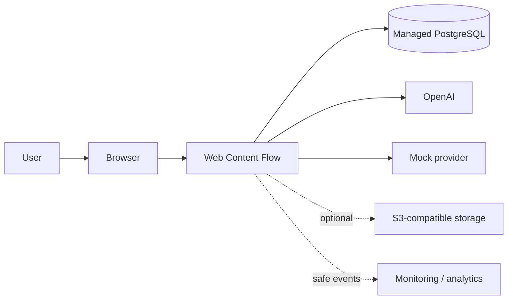

# System Context

Web Content Flow is one product boundary containing the Next.js application and worker. The browser is untrusted. Database, AI, storage, and observability are external managed dependencies. OpenAI is the only proposed real provider for MVP; mock requires no network/key.

Related: [Architecture Overview](../../docs/technical/01-architecture-overview.md).
