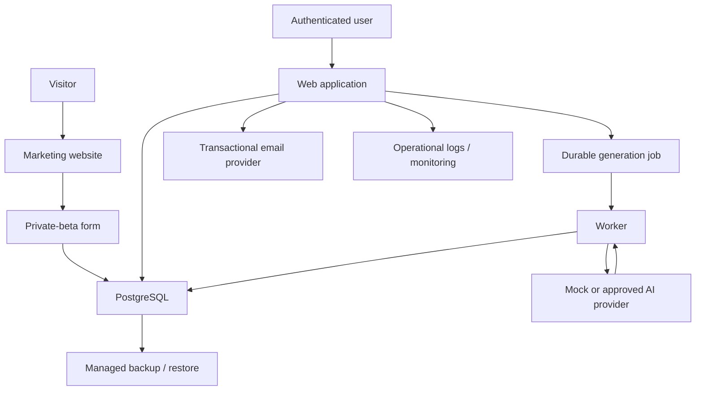

# Data Flow Map

Personal data enters through accounts, recovery and beta interest. Customer content enters through Briefs and edits. Only necessary generation context should reach the AI provider. Logs and analytics must never contain full Briefs, prompts, generated snapshots, passwords, tokens or beta-form free text.

Monitoring, managed backups, external email and real AI flows are proposed or locally implemented but not externally verified.
