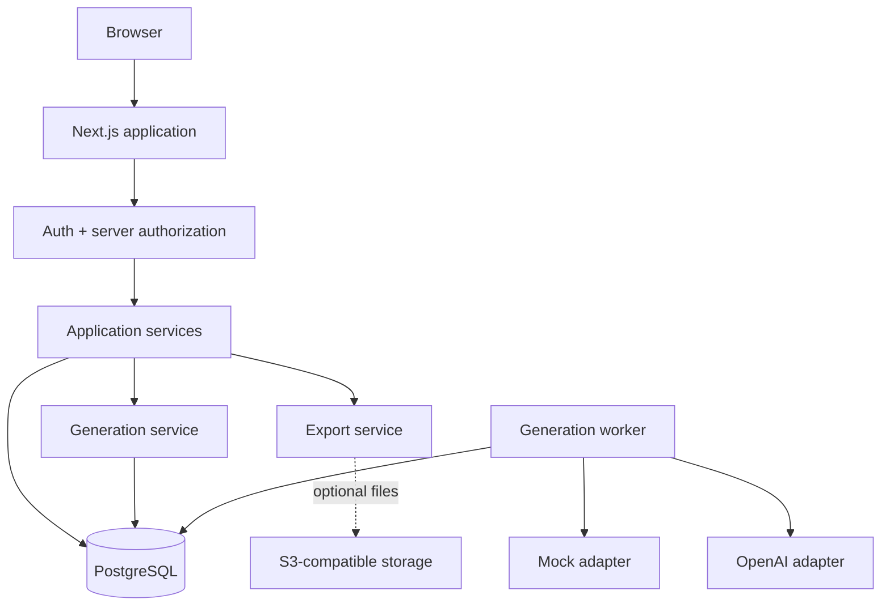

# Architecture Overview

## Goals and style

A modular monolith supports one deployable Next.js application plus a separately runnable worker sharing PostgreSQL and domain packages. It favors managed infrastructure, Server Components, server-enforced authorization, relational ownership, structured AI outputs, durable jobs, immutable versions, and mock parity. No microservices, event sourcing, generic workflow engine, or WebSockets are required.

## Major components and ownership

- Browser owns transient interaction state and unsaved local recovery only.
- Next.js owns rendering, mutations, auth/session integration, authorization, application services, and synchronous exports.
- PostgreSQL is authoritative for projects, versions, jobs, calendar references, and operational state.
- Worker leases durable jobs, calls an adapter, validates output, and commits versions/results.
- AI providers return untrusted structured candidates; they never own application state.
- Optional storage owns generated export files only when persistence is justified.

## Lifecycles

Request: browser → server route/action → session → resource authorization → Zod validation → service → repository/transaction → safe result → render.

Generation: authorized command → idempotency lookup → job persisted QUEUED → worker lease → context build → adapter → Zod validation → immutable version transaction → job completion → polling refresh.

Export: authorized selection → normalize current versions → renderer → synchronous download for normal MVP size; large export may become ExportJob → optional short-retention object.

## Trust boundaries

Browser input, AI output, uploaded/reference URLs, and generated text are untrusted. Server session and indexed ownership queries establish authority. Secrets stay server/worker-side. Generated HTML is never rendered as trusted markup.

## Deployment

Vercel-compatible Node.js application plus deployment-dependent Node worker, one regional PostgreSQL database, OpenAI, and optional storage. Serverless request functions are not treated as a queue; jobs survive process termination in PostgreSQL.

## MVP limitations

Single-user ownership; one real AI provider; polling; light mode; no publishing, rendered image/video, website builder, teams, collaboration, or advanced analytics.

Related diagrams: [Containers](../../architecture/diagrams/application-container.md), [Generation](../../architecture/diagrams/generation-sequence.md), [Data Flow](../../architecture/diagrams/project-data-flow.md).
